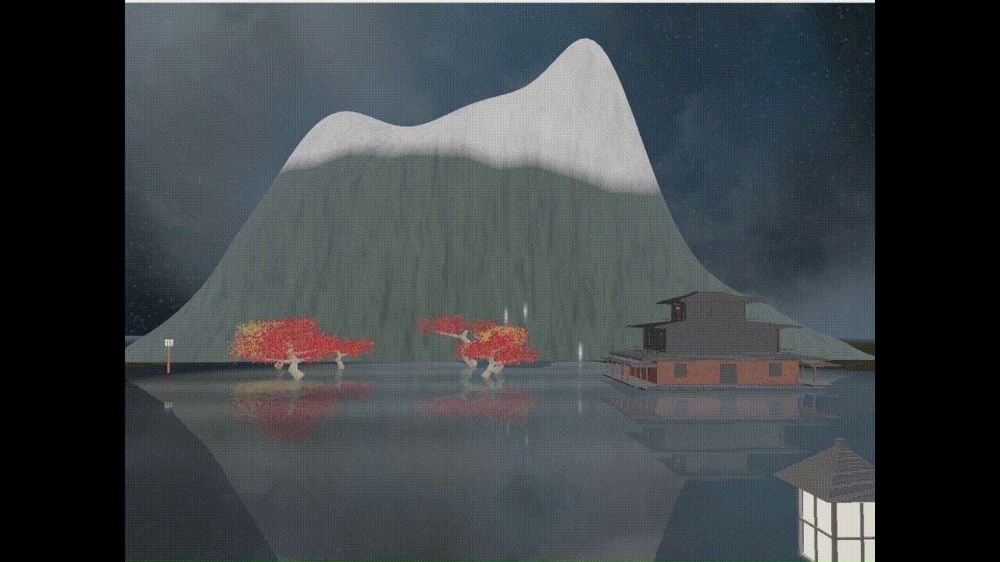

# 3D Fireworks and Water Reflection System

Computer Graphics final project: a real-time OpenGL scene where fireworks launch over a lake at night, light up the surrounding landscape, and reflect on a moving water surface.

<p align="center">
  
</p>

▶ **[Watch the demo video](https://youtu.be/mTzf21fB2oM)**

## Built on

This project extends [Master7Sword/CG-FinalProject](https://github.com/Master7Sword/CG-FinalProject), an OpenGL fireworks particle system by students at Sun Yat-sen University.

The original provides the particle system (launch, burst, fade, trails), custom image-pattern explosions, the camera, skybox loading and sound effects. Everything listed under **What we added** was built by our team.

## What we added

**Scene**

- **Lake**: a polygon mesh animated with time-varying sine waves, shaded with Fresnel blending of water color, lighting, specular highlights and reflections.
- **Lake shore**: a ground mesh with height- and position-based variation and procedural noise for a natural land–water transition.
- **Mountains**: a triangle mesh whose color blends from rock to snow by world-space height, with procedural normal perturbation for slope shading.
- **Trees**: procedurally generated with polar-coordinate placement, blob-based silhouette deformation and layered noise; leaves rendered as instanced billboards in a single draw call.
- **Torii, lanterns and a house** to complete the scene.
- **Skybox** reworked as a spherical shell sampled from a cubemap.

**Rendering**

- **Water reflections**: fireworks are rendered into a reflection texture, sampled with perspective-correct UVs distorted by the wave normals, with a Schlick Fresnel term so reflections strengthen at grazing angles.
- **Dynamic lighting**: each explosion creates a point light with color, intensity and lifetime, passed to the shaders of the static scene with distance attenuation.
- **Particle rendering**: camera-facing billboards with a Gaussian fall-off and additive blending for soft, glowing particles.
- **HDR pipeline**: bright-pass extraction, blur and tone mapping for bloom.

## Problems we solved

- **Mirror-like water.** The lake reflected too much light, and explosion flashes washed out the firework reflections. We split water shading into two parameter sets (with and without active fireworks) and darkened the base water color.
- **Leaves cut off by the lake.** Semi-transparent leaves did not write depth, so the lake, drawn later, wrongly covered the trees and their reflections. We enabled depth writes for leaves while keeping alpha blending, and fixed the draw order: opaque objects, then leaves, then water.

## Build and run

Linux:

```bash
sudo apt install -y mesa-utils libgl1-mesa-dev libglew-dev libglfw3-dev build-essential libglm-dev libsfml-dev

cd code
mkdir build && cd build
mkdir build && cd build
cmake ..
make
./firework
```

macOS:

```bash
macOS:

```bash
brew install llvm libomp glew glfw3 sfml glm
export CC=/usr/local/opt/llvm/bin/clang
export CXX=/usr/local/opt/llvm/bin/clang++
```

**Controls:** WASD to move, arrow keys to look around.

If you see `MESA: error: ZINK: failed to choose pdev`, update the Mesa drivers:

```bash
sudo add-apt-repository ppa:kisak/kisak-mesa
sudo apt update && sudo apt upgrade
```
**Controls:** WASD to move, arrow keys to look around.

If you see `MESA: error: ZINK: failed to choose pdev`, update the Mesa drivers:

```bash
sudo add-apt-repository ppa:kisak/kisak-mesa
sudo apt update && sudo apt upgrade
```

## Docs

- [CG_FinalProject_docs](CG_FinalProject.pdf)
- [CG_FinalProject_slides](https://docs.google.com/presentation/d/1ajTstrQoip6OWA8NbVDGIMCe_c6_Sw5WBUqGMfSdses/edit?usp=sharing)

## Team

| Member | Contributions |
| --- | --- |
| 陳奕潔 | Water surface and reflections, scene construction, analysis of the original codebase, technical research, video recording |
| 陳宥臻 | Firework particles and explosions, scene construction, analysis of the original codebase, technical research |